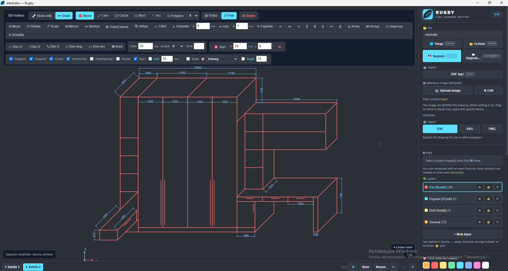

# Rugby Desktop

Windows uchun 2D chizma va CNC burchak tahrirlash dasturi. Bir faylda bir nechta
sahifa, almashtiriladigan hotkeylar, DXF, dogbone, T-bone, fillet va chamfer.

## Yuklab olish

**[Rugby-Portable.exe — Windows x64](https://github.com/iamsanbek-blip/MyCAD/releases/download/v1.1.0-preview.2/Rugby-Portable.exe)**

Faylni yuklab oling va ikki marta bosing. O‘rnatish, ZIP ajratish yoki CMD
ishlatish kerak emas. Sozlamalar Windows foydalanuvchi profilida saqlanadi.

Bu **imzosiz sinov versiyasi**. SmartScreen ogohlantirsa va tugma mavjud bo‘lsa:
**More info → Run anyway**. Smart App Control esa uni bloklashi mumkin;
kod imzolash sertifikati hali yo‘q.

[Reliz va SHA256](https://github.com/iamsanbek-blip/MyCAD/releases/tag/v1.1.0-preview.2)
· [Xato haqida yozish](https://github.com/iamsanbek-blip/MyCAD/issues)

## Dastur ko‘rinishi

## Tez boshlash

- Pastdagi **+** — yangi sahifa; **Ctrl+PageUp / PageDown** — sahifalar orasida o‘tish.
- **Ctrl+S** — barcha sahifalarni bitta `.dbe` fayliga saqlash; **Ctrl+O** — ochish.
- **F10** — hotkeylarni o‘zgartirish; **Ctrl+Z / Ctrl+Y** — bekor qilish/qaytarish.
- [Ikki sahifali namuna](namunalar/ikki-sahifa.dbe) bilan sinab ko‘ring.

Eski loyihalarni avval boshqa nom bilan saqlang. DXF/PNG eksport aktiv sahifaga
tegishli; G-code uchun DXFni CAM dasturiga o‘tkazing.

## Dasturchilar uchun

Node.js 24 bilan: `npm ci`, `npm start`. Tekshirish: `npm run check`, `npm test`.

[Kod tuzilishi](docs/ARCHITECTURE.md) · [Tekshiruvlar](docs/TESTING.md) ·
[Build va reliz](docs/GITHUB-RELEASE.md) · [Batafsil qo‘llanma](docs/DEVELOPMENT.md)

Hozircha ochiq kod litsenziyasi belgilanmagan (`UNLICENSED`).
